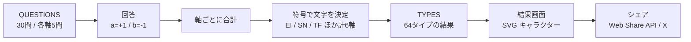

# 恋するへびべあ診断 — 毒舌MBTI恋愛診断（全64タイプ）

> 本プロジェクトは **Claude Code を用いたAI駆動開発** で設計・実装しました。

よくある16タイプ診断では物足りない人のための、6つの軸・全30問・全64タイプで恋愛傾向を判定する毒舌診断です。
HTML 1枚で完結する静的サイトで、サーバーもビルドも不要です。

## 構成図



## 技術スタック

| 分類 | 使用技術 |
|---|---|
| フロントエンド | HTML / CSS / Vanilla JavaScript（単一ファイル） |
| 描画 | インライン SVG |
| フォント | Google Fonts |
| シェア | Web Share API, X（Twitter）Intent, OGP |

## 主な機能

- **30問の質問で6軸を判定** → 2^6 = **64タイプ** の結果を表示
- タイプごとの **毒舌コメント** と SVG のキャラクター
- **結果のシェア**：スマホは Web Share API、PCは X の投稿画面へ
- OGP 設定済みで、SNS でシェアしたときにカード表示される

## 工夫した点

- **引き分けが起きない設計**：1軸あたりの質問数を奇数（5問）にして、合計の符号だけでタイプが一意に決まるようにした
- **データとロジックの分離**：質問（`QUESTIONS`）、軸の定義（`AXIS`）、タイプ文言（`TYPES`）を定数にまとめ、文言の調整がロジックに影響しないようにした
- **依存ゼロ**：外部ライブラリを使わない HTML 1枚なので、どの静的ホスティングにもそのまま置ける

## セットアップ

```bash
git clone https://github.com/ten-ten66/hebibea-shindan.git
cd hebibea-shindan
python3 -m http.server 8080   # → http://localhost:8080
```

`index.html` をブラウザで直接開いても動きます。公開するときは GitHub Pages や Netlify などにそのまま置けます（OGP 画像 `ogp.png` は別途用意してください）。
