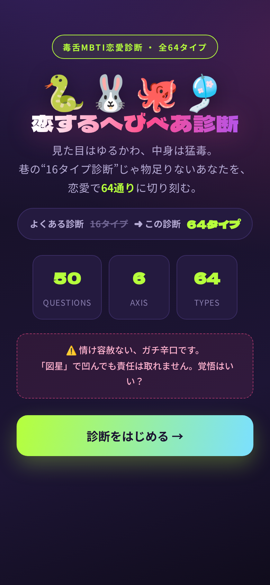
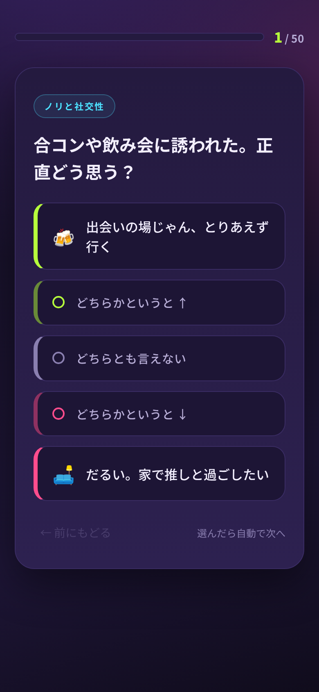
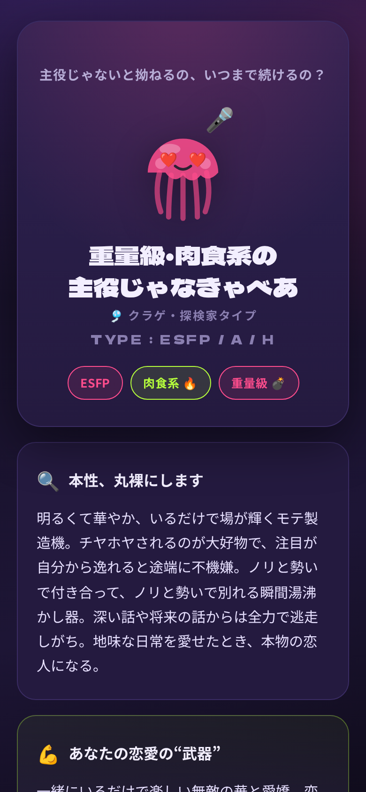
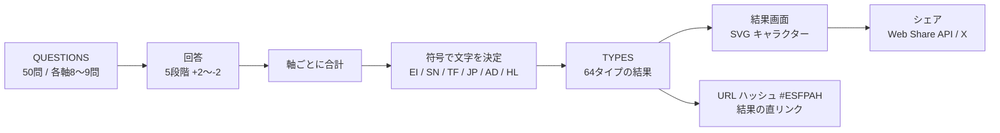

# 恋するへびべあ診断 — 毒舌MBTI恋愛診断（全64タイプ）

> 本プロジェクトは **Claude Code を用いたAI駆動開発** で設計・実装しました。

よくある16タイプ診断では物足りない人のための、6つの軸・全50問・全64タイプで恋愛傾向を判定する毒舌診断です。
HTML 1枚で完結する静的サイトで、サーバーもビルドも不要です。

<p>
  
  
  
</p>

## 構成図



## 技術スタック

| 分類 | 使用技術 |
|---|---|
| フロントエンド | HTML / CSS / Vanilla JavaScript（単一ファイル） |
| 描画 | インライン SVG（キャラクターをコードで生成） |
| フォント | Google Fonts |
| シェア | Web Share API, X（Twitter）Intent, OGP |

## 主な機能

- **50問・5段階の回答で6軸を判定** → 2^6 = **64タイプ** の結果を表示
- MBTI の4軸に「肉食 / 草食」「重い / 軽い」の2軸を加えた独自の判定
- タイプごとの **毒舌コメント**、恋愛の武器・地雷、相性の良い / 悪いタイプ
- 生き物のキャラクター（ヘビ・うさぎ・タコ・クラゲ）を **SVG で描画**
- **結果の直リンク**：`#ESFPAH` のような URL ハッシュで結果画面を直接開ける（ブラウザの戻る / 進むにも対応）
- **シェア**：スマホは Web Share API、PCは X の投稿画面へ。OGP 設定済みで SNS ではカード表示

## 工夫した点

- **5段階回答と同点時のルール**：各軸の回答（+2〜-2）を合計し、符号でタイプの文字を決める。合計がちょうど 0 のときは前側の文字に寄せることで、どんな回答でも必ず1タイプに決まる
- **データとロジックの分離**：質問（`QUESTIONS`）、軸の定義（`AXIS`）、タイプ文言（`TYPES`）を定数にまとめ、文言の調整がロジックに影響しないようにした
- **連打対策**：回答後の自動進行をタイマーで管理し、素早く連打しても質問が二重に進まないようにした
- **依存ゼロ**：外部ライブラリを使わない HTML 1枚なので、どの静的ホスティングにもそのまま置ける

## セットアップ

```bash
git clone https://github.com/ten-ten66/hebibea-shindan.git
cd hebibea-shindan
python3 -m http.server 8080   # → http://localhost:8080
```

`index.html` をブラウザで直接開いても動きます。GitHub Pages や Netlify などの静的ホスティングにそのまま置けます。
